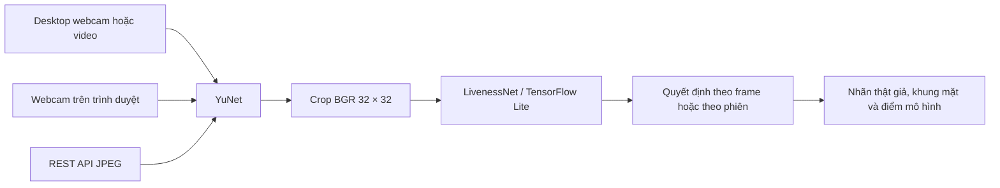
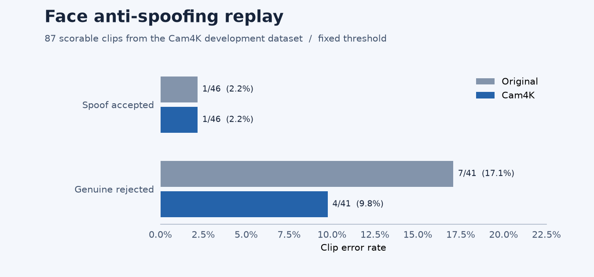

# Face Anti-Spoofing · Camera, Web & REST API

**Nguyễn Chiến Thắng** · Python · OpenCV YuNet · LivenessNet · TensorFlow Lite · Flask

Hệ thống phát hiện khuôn mặt và phân loại thật/giả từ webcam, video hoặc ảnh gửi qua API. Repo gồm ứng dụng desktop, giao diện web, REST API, mã huấn luyện CNN và bộ đánh giá theo video.

https://github.com/user-attachments/assets/84842a19-520e-4eeb-aae9-2bb12d91bd9b

[Cài đặt](#cài-đặt) · [Chạy ứng dụng](#chạy-ứng-dụng) · [Huấn luyện](#huấn-luyện) · [Demo và kết quả](#demo-và-kết-quả)

Bạn có thể xem video và [kết quả đánh giá](#demo-và-kết-quả) ngay trên GitHub. Video dùng khuôn mặt đồ họa minh họa. Nếu trình phát không xuất hiện, mở [bản xem trước GIF](docs/media/demo-preview.gif).

Để kiểm tra API trên máy mới, cài `requirements-local.txt` trong môi trường Python 3.11 rồi chạy lệnh dưới đây từ thư mục gốc. Bộ test gửi ảnh JPEG mẫu qua Flask test client và kiểm tra schema, mã lỗi cùng quyết định theo phiên bằng detector và mô hình giả lập. Bước này không cần webcam, API key hay checkpoint.

```bash
python -m unittest discover -s tests -p test_api.py -q
```

## Kiến trúc



| Thành phần | Mã nguồn |
| --- | --- |
| Desktop webcam và phát lại video | [run.py](run.py), [menu Windows](chay_test_camera.bat) |
| Web demo và tài nguyên giao diện | [web_app.py](web_app.py), [static](static/) |
| REST API và Python client | [api_app.py](api_app.py), [client](clients/antispoof_client.py), [tài liệu API](docs/API.md) |
| Phát hiện mặt, suy luận và quyết định theo phiên | [pipeline.py](pipeline.py), [inference_runtime.py](inference_runtime.py) |
| CNN, trích xuất dữ liệu và huấn luyện | [LivenessNet](model/livenessnet.py), [train_liveness.py](train_liveness.py), [scripts](scripts/) |
| Kiểm thử và báo cáo | [tests](tests/), [evaluate.py](evaluate.py), [replay.json](docs/replay.json) |

## Cài đặt

Dùng **Python 3.11**. Ví dụ PowerShell dưới đây cài các thư viện để chạy webcam, web, API và đánh giá TFLite trên CPU. Chạy từ thư mục gốc repo.

```powershell
python -m venv .venv
.\.venv\Scripts\Activate.ps1
python -m pip install -r requirements-local.txt

$GroupProject = 'C:\path\to\face_anti_spoofing'
.\scripts\setup_local_models.ps1 -Source $GroupProject
```

Đổi `$GroupProject` thành thư mục đồ án đã có trên máy. Script lấy hai checkpoint TFLite và đặt vào `web_models/`. Có thể thêm `-IncludeKeras` nếu cần bản H5 và label encoder cho các script cũ. Detector OpenCV và các file nhãn JSON đã có sẵn. Video, dữ liệu huấn luyện và trọng số liveness của nhóm được quản lý cục bộ.

## Chạy ứng dụng

**Webcam desktop.** Dùng camera index `0` hoặc đổi sang `1` tùy thiết bị. Nhấn **Q** hoặc **Esc** để thoát. Thêm `--input path/to/video.mp4` để phát lại video, hoặc mở menu [chay_test_camera.bat](chay_test_camera.bat).

```powershell
python run.py --camera 0 --model web_models/liveness_cam4k.tflite --le web_models/labels_cam4k.json
```

**Web demo.** Sau khi chạy lệnh, mở [localhost:8080](http://127.0.0.1:8080) và cấp quyền camera trong trình duyệt.

```powershell
python web_app.py
```

**REST API.** API nghe ở cổng 8000 theo mặc định. Dùng `GET /v1/health` để kiểm tra trạng thái, `GET /openapi.json` để xem hợp đồng và `POST /v1/analyze` để chấm một ảnh JPEG. Có thêm endpoint quản lý phiên nhiều frame. Khi chạy trên localhost, API key là tùy chọn. Khi mở API trên mạng, đặt `ANTISPOOF_API_KEY` trước khi chạy. [Hướng dẫn tích hợp](docs/API.md)

```powershell
python api_app.py --model web_models/liveness_cam4k.tflite --labels web_models/labels_cam4k.json
```

## Huấn luyện

Dùng môi trường Python 3.11 riêng cho TensorFlow/Keras và cài [requirements.txt](requirements.txt). Tách video theo người và phiên quay trước khi trích frame, rồi chuẩn bị cây thư mục `video cam4k/{train,validate,test}/{real,fake}/`.

```powershell
python -m pip install -r requirements.txt
python scripts/extract_cam4k.py --input-root "video cam4k" --output-root dataset_cam4k --skip 5
python scripts/train_cam4k.py --dataset dataset_cam4k --epochs 18 --output outputs/cam4k
```

Ngoài Cam4K, repo có các script chuẩn bị dữ liệu gộp, so sánh BatchNorm/GroupNorm và đánh giá theo video. [Tài liệu huấn luyện](docs/TRAINING.md)

## Demo và kết quả

[Ma trận nhầm lẫn và báo cáo JSON](docs/replay.json)

Lần chạy trên **91 video của đồ án** có **87 clip đủ điều kiện chấm**. Hai checkpoint dùng cùng bộ phát hiện mặt, quy tắc lấy mẫu và ngưỡng 0,5.



| Checkpoint | Clip giả bị nhận là thật | Clip thật bị nhận là giả | ACER gộp |
| --- | ---: | ---: | ---: |
| Original | 1/46 · 2,17% | 7/41 · 17,07% | 9,62% |
| Cam4K | 1/46 · 2,17% | **4/41 · 9,76%** | **5,97%** |

Cam4K từ chối nhầm ít hơn ba clip thật trong lần chạy này. Công cụ đánh giá lấy trung bình điểm từ các frame có đúng một mặt. Các clip từng dùng để huấn luyện Cam4K, nên số liệu mô tả lần chạy lại trên dữ liệu hiện có. Hình khuôn mặt trong video là đồ họa minh họa.

Để tái tạo báo cáo sau khi nạp hai checkpoint, dùng:

```powershell
python evaluate.py --data "$GroupProject\data\supplied-20261021" --detector face_detector/face_detection_yunet_2023mar.onnx --model original=web_models/liveness.tflite --model cam4k=web_models/liveness_cam4k.tflite --output reports/replay.json
```

*Đồ án nhóm Face Anti-Spoofing.* [Repo nhóm](https://github.com/thanhAI408/face_anti_spoofing)
