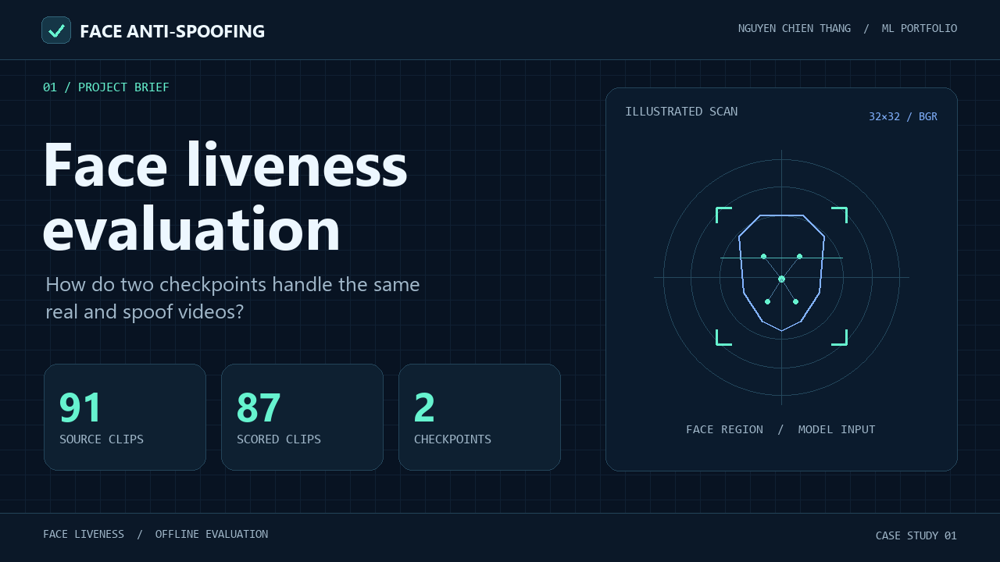
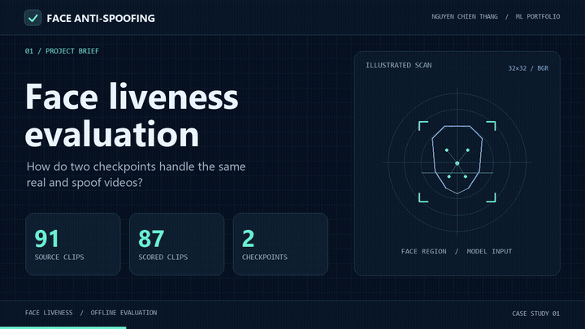

# Face Anti-Spoofing · Face Liveness Evaluation

**Nguyễn Chiến Thắng** · Machine Learning Portfolio · Python / OpenCV YuNet / TensorFlow Lite

[](docs/media/face-liveness-demo.mp4)

[Xem demo 19 giây](docs/media/face-liveness-demo.mp4) · [Kết quả](#kết-quả) · [Chạy lại](#chạy-lại) · [Báo cáo JSON](docs/replay.json)

Tôi đánh giá một bước trong quy trình xác thực khuôn mặt. Khi đưa cùng video thật và video giả qua hai checkpoint, model nào từ chối nhầm ít người thật hơn, và bao nhiêu video giả vẫn lọt qua? Tôi xây dựng CLI để chạy cả hai trên cùng dữ liệu, đo hai loại lỗi riêng và ghi lại các trường hợp hệ thống không thể chấm.

## Kết quả

**91 clip đầu vào** gồm 47 clip giả và 44 clip thật. Cả hai checkpoint dùng cùng bộ phát hiện mặt, cách lấy mẫu và ngưỡng 0,5. Có **87 clip** và **1.712/2.098 frame lấy mẫu** đủ điều kiện chấm.

| Checkpoint | Clip giả bị nhận là thật | Clip thật bị nhận là giả | ACER gộp |
| --- | ---: | ---: | ---: |
| Original | 1/46 · 2,17% | 7/41 · 17,07% | 9,62% |
| Cam4K | 1/46 · 2,17% | **4/41 · 9,76%** | **5,97%** |

**Cam4K từ chối nhầm ít hơn 3 clip thật.** Cả hai cùng nhận nhầm 1 clip giả. Ở cấp frame, Cam4K nhận nhầm nhiều frame giả hơn (3,37% so với 2,81%) nhưng từ chối nhầm ít frame thật hơn (11,44% so với 19,71%). [Ma trận nhầm lẫn và kết quả đầy đủ](docs/replay.json)

## Demo

[](docs/media/face-liveness-demo.mp4)

Video minh họa quy trình và trực quan hóa số liệu từ lần chạy thật. Hình khuôn mặt trong demo là đồ họa minh họa. [Xem bản MP4 đầy đủ](docs/media/face-liveness-demo.mp4)

## Phần tôi thực hiện

- **CLI đánh giá chung.** Đọc mỗi clip một lần, phát hiện mặt bằng YuNet và đưa đúng cùng frame, cùng crop vào cả hai checkpoint TFLite. [Mã nguồn](evaluate.py)
- **Quy tắc chấm và độ bao phủ.** Chấm frame có đúng một khuôn mặt. Ghi riêng các frame không có mặt hoặc có nhiều mặt và số clip không đủ điều kiện.
- **Báo cáo ở hai cấp.** Dùng điểm liveness trực tiếp ở cấp frame, lấy trung bình các frame đủ điều kiện ở cấp clip. Xuất ma trận nhầm lẫn, APCER gộp, BPCER và ACER ở cả hai cấp.

```text
Video có nhãn → Lấy mẫu → YuNet → Crop 32 × 32 → Original / Cam4K
                                                ↓
                          Báo cáo JSON ← Điểm từng frame và từng clip
```

## Chạy lại

Dùng Python 3.11. Sau khi kích hoạt môi trường ảo, cài dependencies và đặt `$GroupProject` thành thư mục chứa dữ liệu, checkpoint và YuNet.

```powershell
python -m pip install -r requirements.txt

$GroupProject = 'C:\path\to\face_anti_spoofing'
python evaluate.py `
  --data "$GroupProject\data\supplied-20261021" `
  --detector "$GroupProject\face_detector\face_detection_yunet_2023mar.onnx" `
  --model "original=$GroupProject\web_models\liveness.tflite" `
  --model "cam4k=$GroupProject\web_models\liveness_cam4k.tflite" `
  --output reports/replay.json
```

Thư mục truyền vào `--data` có hai thư mục con `Video fake` và `Video real`. Mặc định lấy mẫu khoảng 2 frame/giây trong 12 giây đầu, chấm `real` khi điểm lớn hơn 0,5. Xem thêm bằng `python evaluate.py --help`.

## Phạm vi đánh giá

Các clip đã từng dùng để huấn luyện Cam4K. Đây là kết quả chạy lại trên bộ dữ liệu hiện có. Để đo khả năng tổng quát hóa, bước tiếp theo là giữ riêng người và phiên quay cho tập test, cố định ngưỡng trên validation và báo tỷ lệ lỗi theo từng loại giả mạo.

*Case study cá nhân từ đồ án nhóm Face Anti-Spoofing.* [Dự án nhóm](https://github.com/thanhAI408/face_anti_spoofing)
